# Guia do schema do banco ACESSO

Este documento descreve o schema `public` do PostgreSQL/Supabase e a responsabilidade de cada grupo
de tabelas. É um guia de leitura e manutenção; a fonte executável da estrutura continua sendo os
arquivos SQL em `migrations/`.

> **Inventário auditado:** 32 tabelas funcionais da aplicação e 1 tabela técnica de controle de
> migrations (`migracoes_aplicadas`), totalizando 33 tabelas em `public` no momento desta revisão.
> Atualize este inventário quando uma nova migration criar ou remover tabelas.

## Visão geral por domínio

| Domínio | Tabelas | Responsabilidade |
| --- | --- | --- |
| Contas e autenticação | `usuarios`, `sessoes`, `tokens_push`, `codigos_recuperacao_senha`, `codigos_verificacao_email` | Conta principal, sessões, dispositivos e fluxos separados de recuperação de senha e confirmação de e-mail. |
| Preferências | `preferencias_acessibilidade`, `preferencias_notificacao` | Preferências individuais de acessibilidade e categorias de notificações. |
| Perfis e dados profissionais | `candidatos`, `empresas`, `deficiencias`, `candidato_deficiencias`, `candidato_experiencias`, `candidato_formacoes`, `candidato_certificados`, `candidato_habilidades` | Perfis de candidato/empresa e histórico profissional detalhado. |
| Vagas e recrutamento | `vagas`, `candidaturas`, `favoritos_vaga`, `empresas_seguidas` | Publicação de vagas, candidaturas, favoritos e relação de candidatos com empresas. |
| Rede de usuários | `usuarios_seguidos`, `solicitacoes_seguimento`, `usuarios_bloqueados` | Seguir pessoas, controlar pedidos para perfis privados e bloquear contas. |
| Feed | `postagens`, `postagem_anexos`, `comentarios`, `curtidas`, `compartilhamentos` | Publicações, mídias, comentários/respostas e interações. |
| Comunicação | `conversas`, `mensagens`, `notificacoes` | Conversas privadas, mensagens e avisos enviados aos usuários. |
| Administração e moderação | `denuncias`, `registros_auditoria` | Denúncias, decisões de moderação e trilha de ações administrativas. |
| Controle técnico | `migracoes_aplicadas` | Registra quais arquivos SQL já foram executados em cada banco. Não é uma funcionalidade de usuário. |

## Diagrama de relacionamentos

Mostra as chaves estrangeiras reais entre as tabelas (sem as colunas, para caber numa página). Quando uma
relação aparece duas vezes entre o mesmo par, são duas colunas diferentes (por exemplo, quem segue e quem é seguido).

```mermaid
erDiagram
    usuarios ||--o| candidatos : "perfil"
    usuarios ||--o| empresas : "conta institucional"
    usuarios |o--o{ empresas : "cadastrou (usuario_candidato_id)"
    usuarios ||--o{ sessoes : ""
    usuarios ||--o{ tokens_push : ""
    usuarios ||--o{ codigos_recuperacao_senha : ""
    usuarios ||--o{ codigos_verificacao_email : ""
    usuarios ||--o| preferencias_acessibilidade : ""
    usuarios ||--o| preferencias_notificacao : ""

    candidatos ||--o{ candidato_experiencias : ""
    candidatos ||--o{ candidato_formacoes : ""
    candidatos ||--o{ candidato_certificados : ""
    candidatos ||--o{ candidato_habilidades : ""
    candidatos ||--o{ candidato_deficiencias : ""
    deficiencias ||--o{ candidato_deficiencias : ""

    empresas ||--o{ vagas : "publica"
    vagas ||--o{ candidaturas : ""
    candidatos ||--o{ candidaturas : ""
    vagas ||--o{ favoritos_vaga : ""
    candidatos ||--o{ favoritos_vaga : ""
    empresas ||--o{ empresas_seguidas : ""
    candidatos ||--o{ empresas_seguidas : ""

    usuarios ||--o{ usuarios_seguidos : "seguidor / seguido"
    usuarios ||--o{ solicitacoes_seguimento : "solicitante / destinatário"
    usuarios ||--o{ usuarios_bloqueados : "quem bloqueia / bloqueado"

    usuarios ||--o{ postagens : ""
    postagens ||--o{ postagem_anexos : ""
    postagens ||--o{ comentarios : ""
    comentarios |o--o{ comentarios : "resposta"
    postagens ||--o{ curtidas : ""
    postagens ||--o{ compartilhamentos : ""
    usuarios ||--o{ comentarios : ""
    usuarios ||--o{ curtidas : ""
    usuarios ||--o{ compartilhamentos : ""

    usuarios |o--o{ conversas : "participante A / B"
    conversas ||--o{ mensagens : ""
    usuarios |o--o{ mensagens : "remetente"
    usuarios ||--o{ notificacoes : "destinatário"
    usuarios |o--o{ denuncias : "denunciante / responsável"
    usuarios |o--o{ registros_auditoria : "administrador"
```

`notificacoes`, `denuncias` e `registros_auditoria` também apontam para recursos diversos por `entidade_tipo` +
`entidade_id`: essas referências são polimórficas e não têm chave estrangeira, por isso não aparecem acima.

## Relações importantes

### Contas e perfis

- `usuarios` é a identidade de autenticação e autorização.
- `candidatos` e `empresas` são perfis de domínio ligados à conta por relações 1:1. Não duplicam a autenticação: guardam dados específicos de cada tipo de perfil.
- `empresas.usuario_id` identifica a conta institucional que acessa o painel da empresa.
- `empresas.usuario_candidato_id` identifica a conta pessoal de candidato da pessoa responsável pelo cadastro. São vínculos diferentes e não devem ser fundidos.
- `sessoes` guarda sessões por conta; `tokens_push` guarda tokens por dispositivo, permitindo que uma conta tenha mais de um aparelho.

### Perfil profissional do candidato

- `candidato_experiencias`, `candidato_formacoes`, `candidato_certificados` e `candidato_habilidades` são relações 1:N: um candidato pode ter vários registros de cada tipo.
- `deficiencias` é um catálogo compartilhado. `candidato_deficiencias` é a tabela de ligação N:N e também permite guardar observações daquele vínculo.
- `candidatos.escolaridade` é um resumo do nível de escolaridade informado no cadastro. `candidato_formacoes` guarda o histórico detalhado de cursos/formações. Os campos têm granularidades diferentes; não são duplicatas. A escolaridade é **declarada** pela pessoa: não é calculada a partir das formações e nenhuma regra as mantém em sincronia, então as duas podem divergir.
- O backend monta o perfil completo com associações do Sequelize, sem precisar armazenar uma segunda cópia agregada em `candidatos`.

### Recrutamento e rede

- `vagas` pertence a uma empresa; `candidaturas` relaciona uma vaga a um candidato.
- `favoritos_vaga` registra vagas salvas pelo candidato.
- `empresas_seguidas` representa candidato seguindo empresa. `usuarios_seguidos` representa usuário seguindo usuário; não são a mesma relação.
- `solicitacoes_seguimento` representa uma solicitação pendente para seguir conta privada. `usuarios_seguidos` representa uma relação já estabelecida. `usuarios_bloqueados` representa bloqueio e tem regra própria.

### Feed e comunicação

- `postagens` e `postagem_anexos` são separadas porque uma publicação pode ter vários anexos.
- `comentarios` guarda comentários e respostas por autor, com referência opcional ao comentário-pai.
- `curtidas` e `compartilhamentos` são eventos diferentes, com dados e regras próprios.
- `conversas` representa o relacionamento entre participantes; `mensagens` guarda cada mensagem da conversa. Uma conversa pode conter muitas mensagens.
- `conversas.ultima_mensagem_em` e `ultima_mensagem_previa` são uma **cópia derivada** da última linha de `mensagens`, mantida por `ConversaService` a cada envio para listar e ordenar conversas sem agregação. É a única desnormalização deliberada do schema. O par de participantes é guardado em ordem canônica (`usuario_a_id < usuario_b_id`, `ck_conversas_ordem_canonica`) e é único, então só existe uma conversa por par.
- `notificacoes` é uma caixa de entrada de eventos. Seus campos `entidade_tipo` e `entidade_id` funcionam como referência polimórfica para diferentes recursos, por isso não equivalem a uma única FK tradicional.

## Decisões de normalização

As tabelas abaixo podem parecer candidatas à união, mas mantê-las separadas preserva a cardinalidade ou a regra de negócio:

| Tabelas | Por que manter separadas |
| --- | --- |
| `usuarios` + `candidatos`/`empresas` | Autenticação é diferente de dados específicos de cada perfil. |
| `conversas` + `mensagens` | Relação 1:N; juntar repetiria dados da conversa em cada mensagem. |
| `postagens` + `postagem_anexos` | Relação 1:N; uma postagem pode não ter anexo ou ter vários. |
| Tabelas `candidato_*` | Um perfil pode ter múltiplas experiências, formações, certificados e habilidades. |
| `deficiencias` + `candidato_deficiencias` | Catálogo reutilizável e relação N:N com observações por candidato. |
| `codigos_recuperacao_senha` + `codigos_verificacao_email` | Têm colunas em comum (usuário, hash do código, expiração, `tentativas`, uso), mas finalidade e ciclo de vida diferentes. A recuperação também guarda `token_hash` (o link) e `ip_solicitante`, e usá-la encerra todas as sessões da conta (regra do service, não da tabela). A confirmação guarda `novo_email`, o endereço a confirmar. Unificar economizaria uma tabela ao custo de uma coluna de finalidade e de colunas opcionais por tipo, sem eliminar dado duplicado. |
| `usuarios_seguidos` + `solicitacoes_seguimento` + `usuarios_bloqueados` | Relações com estados e efeitos distintos: seguir, solicitar acesso e bloquear. |
| `preferencias_acessibilidade` + `preferencias_notificacao` | Ambas são 1:1 com usuário, mas pertencem a domínios independentes, têm APIs/services próprios e evoluem por razões diferentes. A união reduziria uma tabela, mas aumentaria o acoplamento sem remover uma redundância real. |

### Redundâncias de implementação identificadas

O perfil detalhado já é persistido em `candidato_experiencias` e `candidato_habilidades`, por meio das rotas de
`/perfil/:recurso`. Os campos escalares antigos `experiencia` e `habilidades` não existem no model
`Candidato` nem na tabela `candidatos`; por isso, não devem permanecer na lista de campos editáveis
nem no validador de `PUT /candidatos/:id`. O cadastro atual grava esses itens nas tabelas próprias.

## Ciclo de vida e exclusão (ON DELETE)

A regra geral é: **o que pertence à pessoa some com ela; o que é histórico de outras pessoas ou da moderação fica,
com a referência esvaziada.** Excluir uma conta é um `DELETE` em `usuarios` e o banco propaga o resto.

| Regra | Onde se aplica |
| --- | --- |
| `CASCADE` (apaga junto) | `sessoes`, `tokens_push`, `codigos_*`, `preferencias_*`, `candidatos`, `empresas` (conta institucional), todas as `candidato_*`, `usuarios_seguidos`, `solicitacoes_seguimento`, `usuarios_bloqueados`, `postagens` (e, por ela, anexos, comentários, curtidas e compartilhamentos), `comentarios`, `curtidas`, `compartilhamentos`, `notificacoes` do destinatário. Apagar uma `empresas` apaga suas `vagas`, e estas as `candidaturas` e `favoritos_vaga`. |
| `SET NULL` (mantém, sem o autor) | `conversas.usuario_a_id` e `usuario_b_id`, `mensagens.remetente_id`, `notificacoes.ator_id`, `denuncias.denunciante_id` e `administrador_responsavel_id`, `registros_auditoria.administrador_id`, `empresas.avaliado_por_id`, `suspenso_por_id` e `usuario_candidato_id`, `sessoes.substituida_por_id`. |

Consequências a ter em mente:

- A outra pessoa de uma conversa continua vendo o histórico depois que alguém exclui a conta. Quando **as duas**
  contas são excluídas, a conversa fica com os dois participantes nulos e não há rotina que a limpe.
- Excluir a conta de candidato que cadastrou uma empresa **não** apaga a empresa: só se perde o registro de quem a
  cadastrou (`empresas.usuario_candidato_id`).
- Arquivos no Supabase Storage (currículo, mídia de postagem) **não** são apagados por `DELETE` no banco; a
  limpeza do bucket é responsabilidade do código que exclui a conta.

## Dados sensíveis e visibilidade

| Dado | Como é guardado | Quem vê |
| --- | --- | --- |
| CPF (`candidatos`) | Cifrado com AES-256-GCM (`cpf_cifrado`) e com hash SHA-256 (`cpf_hash`) só para checar duplicidade. Nunca em texto puro. O CNPJ de `empresas` é guardado do mesmo modo (`cnpj_cifrado`, `cnpj_hash`). | Dono, administrador e empresa com candidatura. |
| Currículo | Só o caminho no bucket privado (`candidatos.curriculo`). Nunca vira URL pública: o acesso é por URL assinada e temporária, gerada depois da autorização. | Dono, administrador e empresa com candidatura. |
| Data de nascimento, gênero, endereço, CEP, pretensão salarial, `necessidades_acessibilidade` | Texto puro no banco. A proteção é o controle de acesso da API, não cifra de coluna. | Dono, administrador e empresa com candidatura. |
| `candidato_deficiencias.observacoes` | Texto livre, pode conter informação de saúde (dado pessoal sensível na LGPD). Tratar como privado. | Dono, administrador e empresa com candidatura. |
| Nome, foto, cidade, estado, país, título, resumo, escolaridade, experiências, formações, habilidades, deficiências declaradas | Texto puro. | Qualquer usuário autenticado (perfil público). |

A separação mora em `src/utils/candidatoPrivacidade.js` e é uma **allowlist**: um campo novo do model nasce
privado até alguém decidir torná-lo público. As duas rotas que expõem um candidato a terceiros
(`GET /candidatos/:id` e `GET /perfil/candidatos/:candidatoId`) usam a mesma função.

## Tabela técnica de migrations

`migracoes_aplicadas` é criada pelo script `scripts/migrar.js`, não representa uma função de negócio
e não deve ser removida para reduzir a contagem. Ela impede que uma migration já aplicada seja
executada novamente. A perda desse controle pode causar tentativa de recriar objetos ou divergência
entre ambientes.

## Segurança e acesso

Todas as tabelas de `public` estão com RLS habilitado. No desenho atual, o backend faz a conexão com
a credencial definida no servidor e aplica autenticação/autorização nas rotas e services. Não há
políticas RLS de usuário final definidas nas tabelas da aplicação. Portanto:

- o Backend conecta com um papel que ignora o RLS (`BYPASSRLS`); é por isso que o RLS sem políticas não o atrapalha. `anon` e `authenticated`, os papéis da API REST do Supabase, não têm nenhum `GRANT` nas tabelas e ainda esbarram no RLS sem políticas, então ficam trancados duas vezes;
- a extensão `unaccent` e a `pg_trgm` ficam em `public` de propósito (`acesso_normalizar` e os índices de busca dependem delas); o linter do Supabase avisa isso como `extension_in_public`;
- nunca coloque credenciais do banco ou a chave privilegiada do servidor no frontend;
- mantenha as operações do banco no backend;
- qualquer mudança para acesso direto do cliente via Supabase exige políticas RLS específicas,
  revisadas e testadas para cada tabela.

## Fora deste banco

O app Android (`App/AcessoApk`) autentica direto no Supabase Auth e guarda o perfil numa tabela `perfis`,
criada por `App/AcessoApk/supabase/001_perfis.sql`. Esse script **não** faz parte das migrations deste
diretório e as contas do app **não** estão em `usuarios`. O projeto Supabase usado pelo app é o configurado em
`URL_SUPABASE` (ver o README do app); na revisão de 31/10/2026, o banco descrito aqui não tinha tabela `perfis`
nem registros em `auth.users`.

## Onde conferir a implementação

- Estrutura física e constraints: `migrations/0001_esquema_inicial.sql` e migrations incrementais.
- Models e associações ORM: `src/models/` e `src/models/index.js`.
- Regra de negócio: `src/services/`.
- Endpoints: `src/routes/` e `src/controllers/`.
- Histórico de evolução: [README das migrations](migrations/README.md).
